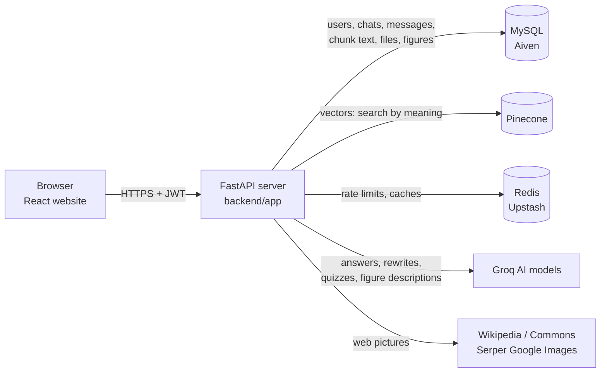

# Study Assistant: how this project works

This guide explains the whole project: what it does, how the parts fit together, and what every
folder, file and function is for. Read it top to bottom the first time; later, jump to the file
you're looking at.

**Contents**

1. [What the app does](#1-what-the-app-does)
2. [Architecture at a glance](#2-architecture-at-a-glance)
3. [The four main flows](#3-the-four-main-flows)
4. [Folder map](#4-folder-map)
5. [Backend files and functions](#5-backend-files-and-functions)
6. [Frontend files and functions](#6-frontend-files-and-functions)
7. [Database tables](#7-database-tables)
8. [API endpoints](#8-api-endpoints)
9. [Tests](#9-tests)
10. [Configuration and deployment](#10-configuration-and-deployment)
11. [Glossary](#11-glossary)

---

## 1. What the app does

A student signs up, creates a **chat**, uploads study material (PDF, DOCX, TXT, MD, PNG, JPG) and
asks questions. The app answers **only from those documents**, cites the passages it used
(`[1]`, `[2]`), shows diagrams from the documents, can add pictures from the web, and can make
multiple-choice **quizzes** from the documents.

The technique is called **RAG (Retrieval-Augmented Generation)**: first *retrieve* the relevant
passages from the documents, then let an AI model *generate* an answer from only those passages.

---

## 2. Architecture at a glance



| Piece | Technology | Job |
|---|---|---|
| Website (frontend) | React + TypeScript, built with Vite | Screens: login, chats, documents panel, quizzes |
| Server (backend) | Python 3.12, FastAPI, async SQLAlchemy | All logic: auth, uploads, search, answers, limits |
| Main database | MySQL / MariaDB (Aiven in production, SQLite in tests) | Everything except vectors |
| Vector database | Pinecone (serverless) | Finds chunks with a similar *meaning* |
| Cache / limits | Redis (Upstash); optional | Rate limits, web picture cache, job queue (Docker setup) |
| AI | Groq: `openai/gpt-oss-120b` (answers), `gpt-oss-20b` (fast/fallback), a vision model (figures) | Writing answers, rewriting follow-ups, quizzes, describing diagrams |
| Embeddings | Multilingual MiniLM, ONNX, runs on the server's CPU | Turns text into 384 numbers that capture meaning |
| Hosting | Render (free): `edu-api` (Docker) + `edu-web` (static site) | Runs the server and the website |

**Layers inside the backend** (a request goes down, the response comes back up):

```
api/        HTTP endpoints: check input, call services, shape the response
  ↓
services/   The real work: documents, search, answers, figures, quizzes, limits
  ↓
models.py   Database tables (SQLAlchemy)     providers.py   AI / Pinecone clients
  ↓                                            ↓
MySQL                                        Groq, Pinecone, local embedding model
```

---

## 3. The four main flows

### 3.1 Upload a document

```
DocumentsPanel.tsx ─POST /documents─▶ api/documents.upload_document
   └▶ services/documents.save_upload
        ├ storage.save_upload        save to disk + SHA-256 fingerprint
        ├ _find_same_file            same file uploaded before? → reuse it (no processing)
        ├ stored_files.save          copy of the file into MySQL (survives restarts)
        └ jobs.enqueue_ingestion ─▶ services/ingestion.ingest_document
              extract_text (OCR if needed; Symbol-font fix) → mathtext.read_math_pages
              (math pages re-read as LaTeX by the vision model) → split_text into chunks
              → embedder.embed_documents → Pinecone upsert → chunks in MySQL
              → status "ready"  → figures.mark_processing
                    └▶ services/figures.process_document (background, minutes)
                          extract_candidates → _describe (vision model)
                          → FigureImage rows + caption chunks → Pinecone
```

The browser polls `GET /sections/{id}/documents` to show "processing → ready → N figures".

### 3.2 Ask a question

```
ChatView.tsx ─POST /sections/{id}/messages (SSE stream)─▶ api/sections.post_message
   ├ retrieval.prefetch_embedding     start embedding the question right away
   ├ ratelimit.enforce_rate_limit     per-minute burst limit
   ├ sections.submit_question         check 30-question quota + daily limit,
   │                                  save question + empty "pending" answer
   └ streaming.start_generation ─▶ rag.generate_answer (background task)
        ├ conversation.recent_history     (in parallel with the search)
        ├ conversation.rewrite_query      only for follow-ups like "explain it more"
        ├ web_images.start_search         pictures, in parallel
        ├ retrieval.retrieve              Pinecone (meaning) + BM25 (keywords) → RRF merge
        ├ no evidence? → fixed "not found in your documents" answer (no guessing)
        ├ build_messages → llm.stream     answer streams word by word to the browser
        ├ extract_citations               which [n] / [[figure:n]] were used
        └ save answer, conversation.update_summary
```

Events sent to the browser: `message_start`, many `token`, `citations`, then `done` (or `error`).

### 3.3 Show a figure

The answer contains `[[figure:3]]` → the frontend's `FigureBlock` calls
`GET /figures/{id}` with the login token → `api/figures.get_figure` checks the student owns the
document and returns the WebP image stored in MySQL.

### 3.4 Quiz

`QuizPanel.tsx` → `POST /sections/{id}/quizzes` → `services/quiz.create_quiz` picks passages
(by topic or a random spread), asks the model for questions that must each cite a passage,
validates them, stores them → the student answers → `POST /quizzes/{id}/attempts` →
`submit_attempt` grades and returns explanations with citations.

---

## 4. Folder map

```
Education app/
├── explain.md              ← this guide
├── README.md               setup, design decisions, deployment notes
├── render.yaml             Render blueprint: edu-api (Docker) + edu-web (static)
├── Dockerfile              API image built from the repo root (used by Render)
├── docker-compose.yml      full local stack: MariaDB, Redis, API, worker, website
├── .env.example            every setting, with comments (copy to .env)
├── .gitignore / .dockerignore
│
├── backend/                Python server
│   ├── Dockerfile          same API image, with ./backend as build context
│   ├── requirements.txt    Python packages (pinned)
│   ├── requirements-dev.txt  + pytest, httpx, aiosqlite for tests
│   ├── pytest.ini          test settings (async mode)
│   ├── schema.sql          reference SQL for the original tables (the app creates all
│   │                       tables itself on startup; models.py is the source of truth)
│   ├── app/
│   │   ├── main.py         creates the FastAPI app, startup tasks, error handling
│   │   ├── config.py       all settings (read from environment / .env)
│   │   ├── db.py           database connection and sessions
│   │   ├── models.py       database tables
│   │   ├── schemas.py      shapes of API requests/responses
│   │   ├── security.py     passwords, JWT tokens, "who is signed in"
│   │   ├── ratelimit.py    request limits (Redis or memory)
│   │   ├── errors.py       AppError: errors with a code the website understands
│   │   ├── storage.py      saving uploaded files on disk
│   │   ├── timing.py       per-answer timing log
│   │   ├── worker.py       background worker (Docker/Redis setup only)
│   │   ├── api/            HTTP endpoints (one file per area)
│   │   └── services/       business logic (one file per feature)
│   └── tests/              automated tests (pytest)
│
└── frontend/               React website
    ├── index.html          the single HTML page
    ├── package.json        npm packages and scripts
    ├── vite.config.ts      build/dev server settings (proxies /api to the backend)
    ├── tsconfig.json       TypeScript settings
    ├── Dockerfile, nginx.conf  serve the built site and proxy /api in Docker
    └── src/
        ├── main.tsx        starts React
        ├── App.tsx         top-level screen: login vs. app, chat list, layout
        ├── api.ts          every call to the backend
        ├── types.ts        TypeScript shapes of the data
        ├── styles.css      all styling (light/dark)
        ├── components/     screen pieces (chat, documents, quiz, …)
        └── visuals/        helpers for charts, math and answer formatting
```

---

## 5. Backend files and functions

Functions starting with `_` are private helpers used only inside their file.

### 5.1 Core (`backend/app/`)

#### `main.py`: the application entry point
| Function / class | What it does |
|---|---|
| `lifespan` | Runs at startup: creates tables, checks Redis, then starts background jobs (warm-up, resume work, backfills). Closes the database at shutdown. |
| `redis_status` | Reports whether Redis is connected, disabled or unreachable. |
| `warm_up` | Loads the embedding model and opens Pinecone early, so the first upload/question isn't slow. |
| `resume_unfinished_ingestion` | Restarts document processing that a server restart interrupted. |
| `move_vectors_to_shared_namespace` | Moves vectors still in old per-student Pinecone namespaces into the shared one (runs `PineconeStore.migrate_user_namespaces`). |
| `reembed_outdated_documents` | If the embedding model changed, re-embeds documents made with the old one. |
| `backfill_figures` | Extracts figures for documents that never had them, or whose extraction was interrupted. |
| `UnhandledErrorMiddleware` | Turns any crash into a clean JSON "500" response (with CORS headers, so the website can read it). |
| `app_error_handler` | Converts an `AppError` into a JSON response with its status code and error code. |
| `health` | `GET /health`: a simple "is the server up" check for Render. |

#### `config.py`: settings
| Name | What it does |
|---|---|
| `Settings` | Every setting in one class (database URL, API keys, limits, model names, timeouts…), read from environment variables or `.env`. `.env.example` documents each one. |
| `get_settings` | Returns the settings (created once and cached). |

#### `db.py`: database connection
| Function | What it does |
|---|---|
| `Base` | Parent class of all tables in `models.py`. |
| `normalize_database_url` | Accepts provider URLs like Aiven's `mysql://…?ssl-mode=REQUIRED` and converts them for the async driver. |
| `_connect_args` | Sets up TLS (encryption) for the MySQL connection, verifying the certificate when `DATABASE_SSL_CA` is set. |
| `_note_last_use` / `_ping_if_idle` | Check a pooled connection only if it sat unused for 60 s (instead of before every query: saves a network round trip). |
| `get_session` | Gives each request its own database session (FastAPI dependency). |
| `create_tables` | Creates any missing tables at startup. |

#### `models.py`: database tables
See [section 7](#7-database-tables) for every table. `utcnow()` returns the current UTC time used for timestamps.

#### `schemas.py`: API data shapes (Pydantic)
Defines and validates what goes in and out of the API: `Credentials` (email + password rules),
`TokenOut`, `UserOut`, `SectionCreate`, `SectionUpdate`, `SectionOut`, `MessageCreate`, `MessageOut`, `DocumentOut`,
`AttachDocument`, `QuizCreate`, `QuizOut`, `QuizQuestionOut`, `AttemptCreate`, `QuestionResult`,
`AttemptOut`. Invalid input is rejected automatically with a 422 error.

#### `security.py`: passwords and login tokens
| Function | What it does |
|---|---|
| `hash_password` / `verify_password` | bcrypt hashing; the plain password is never stored. |
| `DUMMY_HASH` | Checked when an email doesn't exist, so login takes the same time either way (hides which emails are registered). |
| `create_access_token` | Makes a signed JWT with the user id, valid for 7 days. |
| `current_user` | Reads the `Authorization: Bearer` token, verifies it and loads the user (used by most endpoints). |
| `current_user_id` | Same check without the database lookup, for endpoints that then load something owned by that user. |
| `_user_id_from` | Verifies a token's signature and expiry and reads the user id from it. |

#### `ratelimit.py`: request limits
| Function | What it does |
|---|---|
| `get_redis` | The shared Redis client (or none if `REDIS_URL` is empty). |
| `hit` | Counts one request in the current time window; falls back to in-memory counting if Redis is down. |
| `_local_hit` | That in-memory counter. |
| `enforce_limit` | Raises "429 Too many requests" once a key exceeds its limit. |
| `enforce_rate_limit` | Per-user, per-minute limit (questions, uploads…). |
| `client_ip` | The visitor's real IP (from Cloudflare headers when present), for sign-up/login limits. |

#### `errors.py`
`AppError`: an error with an HTTP status, a stable code (e.g. `DAILY_LIMIT_REACHED`) and a
message; the website switches on the code. `to_body()` turns it into JSON.

#### `storage.py`: files on disk
| Function | What it does |
|---|---|
| `path_for` | Builds the file path from user id + document id (never from the user's filename: safe). |
| `save_upload` | Streams the upload to disk, enforces the size limit, computes its SHA-256. |
| `file_sha256` | Fingerprint of a stored file (None if missing). |
| `delete` | Removes a file. |

#### `timing.py`: per-answer timing
`AnswerTimer` records how long each step of an answer took (`step`, `mark_first_word`, `note`,
`report`), logged as one `Answer timing:` line. `start`, `current`, `step` and `now` let any code
in the answer pipeline add its own timing.

#### `worker.py`
Background worker used with Docker + Redis (`INGEST_MODE=queue`, the default): `ingest_document_job`
processes an uploaded document; `WorkerSettings` configures it. On Render, documents are
processed inside the API instead (`INGEST_MODE=inline`).

### 5.2 Endpoints (`backend/app/api/`)

#### `auth.py`
| Function | What it does |
|---|---|
| `register` | Sign up: limits per IP and app-wide, hash password, create user, return a token. |
| `login` | Sign in: limits per IP and per email, check password, return a token. |
| `me` | Returns the signed-in user. |
| `my_usage` | Today's usage of each daily limit. |
| `_token`, `_email_key` | Build the token response; hash an email for use as a rate-limit key. |

#### `documents.py`
| Function | What it does |
|---|---|
| `upload_document` | Saves the upload (or reuses the same earlier file) and starts processing. |
| `list_documents` | All of the student's documents (their library). |
| `document_status` | One document's status and figure progress. |
| `delete_document` | Deletes the document everywhere (file, chunks, vectors, figures). |

#### `sections.py` (a "section" = one chat)
| Function | What it does |
|---|---|
| `create_section`, `list_sections`, `get_section`, `rename_section`, `delete_section` | Manage chats. |
| `list_messages` | The chat's messages. |
| `post_message` | Ask a question; returns the answer as a live stream (SSE). |
| `retry_answer` | Regenerates a failed answer without using another question. |
| `list_section_documents`, `attach_document`, `detach_document` | Which documents this chat may use. |
| `create_quiz` | Makes a quiz from this chat's documents. |
| `_start_payload` | The first stream event (the saved question and pending answer). |

#### `streaming.py`: live answers (Server-Sent Events)
| Function | What it does |
|---|---|
| `start_generation` | Runs answer generation in the background (it finishes and saves even if the browser disconnects) and returns a queue of events. |
| `stream_response` | Sends those events to the browser as they arrive, with a heartbeat every 15 s. |
| `replay_response` | Re-sends an answer that was already completed (when the same question is resubmitted). |
| `_format`, `_events` | Format and loop over SSE events. |

#### `figures.py`
`get_figure`: returns a figure image, only to a student who may read its document (theirs, or a library book).

#### `library.py`
`list_library` (everyone), `add_to_library` and `remove_from_library` (admins only, via `admin_user`).

#### `quizzes.py`
`get_quiz` (questions without answers), `submit_attempt` (grade answers), `quiz_out` (hides the
correct answers until an attempt).

### 5.3 Services (`backend/app/services/`): the real work

#### `documents.py`: the document library
| Function | What it does |
|---|---|
| `save_upload` | Validates type, reserves a daily upload, saves the file + its MySQL copy, or reuses an identical earlier upload. Returns an `UploadResult`. |
| `_find_same_file` | Finds the student's earlier document with the same SHA-256 (or same name + size for very old uploads). |
| `_reuse` | Attaches that earlier document instead of processing again; restores a lost file; re-extracts missing figures. |
| `_figure_images_missing` | Whether any of a document's figures lost their image. |
| `backfill_hashes` | Fingerprints older documents at startup. |
| `with_figure_counts` | Adds figure status/count to documents for the website. |
| `get_owned_document`, `list_documents`, `section_documents` | Look up documents (only the owner's). |
| `UploadResult` | What an upload produced: the document, whether it was a duplicate, whether to extract figures. |
| `attach`, `detach` | Add/remove a document from a chat. |
| `delete_document` | Deletes chunks, vectors, figures, file copy, fingerprint and the file. |

#### `ingestion.py`: turning a file into searchable chunks
| Function / class | What it does |
|---|---|
| `ingest_document` | The full pipeline: read text → re-read math pages as LaTeX → chunk → embed → store in Pinecone and MySQL → mark ready → start figures. Marks the document failed with a readable message on problems. |
| `extract_text` | Gets text page by page from PDF, DOCX, TXT/MD and images; uses OCR for images and scanned pages, and turns Symbol-font characters back into real symbols. |
| `ocr_image`, `_ocr_pdf_pages`, `_tesseract_languages` | OCR with Tesseract, using only the installed languages, after cleaning up the image. |
| `split_text`, `_split_pieces` | Splits text into chunks, keeping paragraphs/sentences whole when they fit. |
| `chunk_pages` | Chunks every page, remembering page numbers. |
| `chunking_for` | Measures chunk size in the embedding model's own tokens so nothing is cut off. |
| `reembed_document` | Re-embeds a document with a new embedding model (from the file, or from stored chunk text if the file is gone). |
| `_record_embedding_model` | Notes which embedding model a document was embedded with. |
| `IngestionError`, `Chunk`, `StepTimer` | A file problem shown to the student; one chunk; timing log for each upload. |

#### `vision.py`: vision models and their rate limits
| Function / class | What it does |
|---|---|
| `VisionChain` | Tries Groq, then each Gemini model in `GEMINI_VISION_MODELS` (each has its own free daily limit); pauses a provider that hits a rate limit; waits out short limits and raises `VisionQuotaExceeded` for long ones, so the work is deferred. |
| `GroqVision`, `GeminiVision` | The two providers: `describe` a figure (JSON) and `transcribe` a page (text with LaTeX). |
| `parse_retry_after` | Reads waits like "try again in 19m30.72s" from rate-limit errors. |
| `create_vision` | Builds the chain from the API keys that are set. |

Deferred work is finished by `main.retry_vision_backlog` (every `VISION_RETRY_MINUTES`): documents in
`vision_backlog` are processed again (saved `page_transcripts` cost nothing), then figures in status `waiting`.

#### `library.py`: the shared library
| Function | What it does |
|---|---|
| `readable_by` | SQL condition for "documents this user may read": their own, or the library's. Used for attaching, retrieval, keyword search, quizzes and figures. |
| `search_owners`, `vector_owner`, `LIBRARY_OWNER` | Library vectors are tagged `"library"` instead of a user id, so a search matches "mine or the library's" without a database query. |
| `get_readable_document` | A document the user may read, or 404. |
| `require_admin`, `is_admin_id` | Admin checks: by email in `ADMIN_EMAILS` (`User.is_admin`), or by user id with a one-minute cache (used by daily limits, which admins skip). |
| `list_library`, `share`, `library_flags` | List library books (users see ready ones), put a document in the library, mark documents that are in it. |

#### `mathtext.py`: math-heavy PDFs (e.g. NCERT textbooks)
| Function | What it does |
|---|---|
| `fix_symbol_font` | Maps Symbol-font private-use characters (U+F020–U+F0FF) back to ∠ Δ = − × α … so the answer model and keyword search can read them. |
| `needs_math_reading` | Spots pages whose text layer lost its math layout (many math symbols, or fractions split over lines). |
| `read_math_pages` | Renders those pages (`render_pages`) and has the vision model transcribe them with math in LaTeX (`PAGE_PROMPT`); up to `MATH_VISION_MAX_PAGES` per document and `DAILY_MATH_PAGE_LIMIT` per student per day. Pages it can't read keep their text. |
| `_accept` | Rejects empty or much-too-short transcripts (a refusal or cut-off reply). |
| `_reserve`, `_refund` | Count a page against the daily limit; give it back if reading failed. |

#### `stored_files.py`: uploads kept in MySQL
Render's free plan wipes the disk on restart, so each upload is also stored in the database.
| Function | What it does |
|---|---|
| `save` | Stores the file in 4 MB parts (one INSERT each). |
| `has_copy` | Whether the database holds a copy. |
| `ensure_local` | Makes sure the file is on disk, restoring it from MySQL if needed. |
| `remove` | Deletes the copy. |
| `_read_parts`, `_write` | Read a file in parts; write a restored file safely (to a temporary name first). |

#### `embeddings.py`: meaning → numbers (runs locally on CPU)
| Function / class | What it does |
|---|---|
| `MultilingualMiniLMEmbedder` | The default model (works in many languages): `embed_documents`, `embed_query`, `count_tokens`. |
| `FastEmbedEmbedder` | Alternative models via fastembed. |
| `create_embedder` | Picks the configured model. |
| `download_multilingual_model`, `prepare_multilingual_model`, `_external_data_path` | Download the model once (it's built into the Docker image) and store its weights as a separate file. |

#### `vectorstore.py`: Pinecone
`PineconeStore` wraps the Pinecone index: `upsert` (save vectors), `query` (find similar vectors,
filtered to the student's `user_id` and the chat's documents), `delete`. Every call has a timeout and
retries. `migrate_user_namespaces` copies vectors from the old one-namespace-per-student layout into
the shared namespace (adding `user_id`, no re-embedding) and deletes the old namespaces. `Match` is one
search result. `_is_ready` checks a newly created index is ready.

#### `providers.py`: which clients to use
`embedder()`, `vector_store()`, `llm()`, `vision()` return the shared clients; tests swap in fakes
with `override()`. `namespace_for()` names the Pinecone namespace all students share (one per
embedding model); `vector_metadata()` builds the metadata stored with each vector, including the
owner's `user_id`, which every search filters on so students only find their own documents. `Embedder`, `VectorStore`, `LLM`, `Vision` describe what each
client must provide.

#### `keyword.py`: keyword search (BM25)
| Function | What it does |
|---|---|
| `tokenize` | Splits text into lowercase words, drops stopwords and LaTeX layout words, trims word endings. `x²`, `x2` and `x^{2}` all become `x2`; section numbers like `6.1` stay whole (plus their parts). |
| `_build_index`, `_indexes`, `_DocumentIndex` | Builds and caches a word index per document (rebuilt when the document changes). |
| `keyword_search` | Scores chunks by matching words (BM25); needs at least 2 matching words for longer questions. |

#### `retrieval.py`: finding the right passages
| Function | What it does |
|---|---|
| `retrieve` | **Hybrid search**: Pinecone (meaning) and BM25 (keywords) in parallel, merged with RRF, top 12 loaded from MySQL. |
| `reciprocal_rank_fusion` | Merges ranked lists: passages ranked well in both win. |
| `prefetch_embedding`, `_embed_query` | Start embedding a question while it's being saved, then reuse the result. |
| `_vector_search` | Embed the query, ask Pinecone, drop weak matches. |
| `_load_chunks` | Loads the winning chunks' text and file names from MySQL (owner's documents only). |
| `_timed` | Times one search step for the timing log. |
| `attach_figures` | Marks passages that describe a figure, so the answer can show the image. |
| `format_sources`, `_defuse` | Puts passages into the prompt as `<source id="n">`, neutralising any text that looks like instructions. |
| `evenly_spaced` | Picks N items spread evenly from first to last. |
| `spread_chunks` | Passages spread evenly through each document, in reading order (for whole-chapter questions: "explain this chapter", "summarise this document"). `rag.chapter_evidence` combines them with the best search matches within `OVERVIEW_PROMPT_CHARS`, and `rag.CHAPTER_RULES` tells the model to teach the whole chapter. |
| `sample_chunks` | A random spread of passages (for quizzes without a topic). |
| `Evidence` | One retrieved passage; `.citation()` turns it into a citation for the website. |

#### `conversation.py`: chat memory
| Function | What it does |
|---|---|
| `recent_history` | The last few messages of the chat. |
| `history_as_chat` | Formats them for the AI (old ones shortened, diagram code removed). |
| `needs_rewrite` | Whether a question depends on earlier messages ("explain it", "and that?"). |
| `rewrite_query` | Turns such a follow-up into a standalone question for searching. |
| `update_summary` | Keeps a short rolling summary of older messages. |
| `_clip`, `_context_text`, `_transcript` | Shorten text; strip old markers and diagram code from answers; format messages for the summary. |

#### `rag.py`: generating the answer
| Function | What it does |
|---|---|
| `generate_answer` / `_generate` | The whole answer pipeline (see flow 3.2); on error, marks the answer failed and tells the browser. |
| `build_messages` | Builds the prompt: rules, sources, web pictures, history, question. |
| `_stream_answer` | Streams from the answer model; if Groq is busy before the first word, switches to the fallback model. |
| `reasoning_effort_for` | Low reasoning (faster) for simple look-ups, medium for comparisons/explanations. |
| `is_overview_question` | Detects "summarise / what is this document about" questions. |
| `extract_citations` | Which sources (`[n]`) and figures (`[[figure:n]]`) the answer actually used. |
| `web_image_citations`, `requested_pictures` | Web pictures the answer shows, and adding them when the student asked but the model left them out. |
| `document_pictures_note` | Explains when the student asked for document pictures that don't exist yet. |
| `AnswerContext`, `_load_context` | The data an answer needs, preloaded by the request (or loaded for retries). |

#### `figures.py`: diagrams from documents
| Function | What it does |
|---|---|
| `process_document` | Extract → describe → store → index all figures of a document (never breaks the document if it fails). |
| `extract_candidates` | Finds images in PDFs (`_pdf_candidates`) and DOCX (`_docx_candidates`); skips icons, strips, whole-page images and repeated logos. Drawn diagrams are found by `_vector_regions`: shapes that touch are grouped (`cluster_boxes`), and each big enough group becomes its own figure, so header rules and fraction bars don't turn the whole page into one "figure". |
| `_describe` | Asks the vision model for a title/description; past the daily limit or on failure, keeps captioned figures by their caption. |
| `caption_from_context` | Reads captions like "Fig: Bluetooth Piconet" from the page. |
| `_reserve_caption`, `_parse_caption` | Count against the daily limit; validate the model's JSON reply. |
| `clear_figures` | Removes a document's figures everywhere. |
| `mark_processing`, `_set_scan`, `figure_counts` | Track and report figure-extraction status. |
| `get_owned_figure`, `figure_key` | Owner check; storage key for an image. |
| `_flatten`, `_fingerprint`, `_encode` | Image helpers: white background, duplicate detection, WebP/JPEG encoding. |
| `Candidate` | One possible figure: page, image bytes, size, the page's text. |

#### `web_images.py`: pictures from the internet
| Function | What it does |
|---|---|
| `image_intent` | Did the student ask for a picture ("explicit"), would one help ("helpful"), or neither. |
| `search_query`, `topic_for` | Extract the topic words to search for. |
| `_wikipedia`, `_commons`, `_google` | Search Wikipedia lead images, Wikimedia Commons files, and Google Images (via Serper, optional). |
| `relevance`, `is_unrelated_person` | Score pictures by topic match; drop logos and unrelated people. |
| `WebImageSearch` | Runs the providers in parallel with a reused connection; `warm_up` opens connections at startup. |
| `find_images` | Cached search (Redis or memory); never raises. |
| `start_search`, `collect`, `PendingSearch` | Start searching alongside the document search; collect results within a time limit (0.8 s, 1.5 s if asked). |
| `format_web_images`, `_clean` | Puts the pictures into the prompt (with cleaned-up text). |
| `image_search`, `override` | The shared search client (tests replace it). |
| `_cache_key`, `_cache_get`, `_cache_set` | The picture cache. |
| `_https`, `_domain` | Keep only https image links; show the source site. |
| `WebImage`, `ImageSearch` | One picture; what a search provider must offer. |

#### `llm.py`: Groq AI clients
`GroqLLM.stream` (answer word by word), `GroqLLM.complete` (one-shot replies: rewrites, quizzes,
summaries), `_reasoning_options` (controls the model's thinking). `GroqVision.describe` describes
a figure image; `GroqVision.transcribe` transcribes a math-heavy page into text with LaTeX. `ModelBusy` signals "rate-limited/overloaded, try another model".

#### `sections.py`: chats and the question quota
| Function | What it does |
|---|---|
| `submit_question` | In one transaction: check the chat is open and has ready documents, reserve a daily question, increase the counter (max 30), save the question and a pending answer. Duplicate submissions (same client id) replay the original. |
| `reset_for_retry` | Puts a failed answer back to pending. |
| `create_section`, `list_sections`, `get_owned_section`, `delete_section`, `list_messages`, `ready_document_ids` | Chat basics (owner-only). |
| `_title_from`, `_closed_error`, `_find_submission` | Chat title from the first question; "chat full" error; find an earlier identical submission. |
| `section_not_found`, `Submission` | The "chat not found" error; what `submit_question` returns. |

#### `quiz.py`: quizzes
`create_quiz` (picks passages, asks the model, validates with `_validate` that each question cites
a real passage and has one correct option), `get_owned_quiz`, `submit_attempt` (grading).

#### `usage.py`: daily limits
| Function | What it does |
|---|---|
| `reserve` | Counts one action (question, quiz, upload, chat, figure, math page) against today's limit, or raises 429. |
| `refund` | Gives one back when the action failed. |
| `get_usage` | Today's counts and limits for the website. |
| `limit_for`, `today`, `resets_at` | The limit for an action; today's UTC date; when it resets (midnight UTC). |
| `_ensure_row`, `_try_increment` | Create today's counter if missing; add one if still under the limit. |

#### `jobs.py`: background work
| Function | What it does |
|---|---|
| `spawn` | Runs a task in the background safely. |
| `enqueue_ingestion` | Processes a document, inline or via the Redis queue. |
| `enqueue_figures`, `enqueue_reembed` | Figure extraction / re-embedding in the background. |
| `_inline_ingestion_slot` | One heavy job at a time, so the small server doesn't run out of memory. |
| `_ingest_inline`, `_reembed_inline`, `_figures_inline` | Those jobs run inside the API process (Render). |
| `arq_redis_settings` | Redis connection for the queue (Docker setup). |

---

## 6. Frontend files and functions

### `src/main.tsx`
Starts React and renders `App` into `index.html`.

### `src/App.tsx`: the top-level screen
`App` shows the login screen or the app. It keeps the signed-in user, the chat list, the active
chat and today's usage; creates/deletes chats; signs out when the server says the token is invalid.

### `src/api.ts`: every call to the backend
| Function | What it does |
|---|---|
| `getToken` / `setToken` | Read/save the login token (browser localStorage). |
| `request` | Sends a request with the token; turns errors into readable `ApiError`s; signs out on 401. |
| `streamSSE` | Reads a streamed answer (SSE) from `fetch`, event by event. |
| `describeError` | Friendly error text (e.g. when a daily limit resets, in local time). |
| `setUnauthorizedHandler` | What to do when the token expires (sign out). |
| `api` | One function per endpoint: `login`, `register`, `listSections`, `uploadDocument` (with progress), `figureImage`, `createQuiz`, … |

### `src/types.ts`
TypeScript shapes matching the API: `User`, `Section`, `Message`, `Citation`, `WebImage`,
`DocumentInfo`, `Quiz`, `Attempt`, `Usage`, `StartEvent`, …

### `src/components/`
| File | What it shows / does |
|---|---|
| `AuthScreen.tsx` | Login and sign-up form. |
| `Sidebar.tsx` | Chat list, "New chat", "Manage library" (admins), and `UsageMeter` (today's limits). |
| `LibraryManager.tsx` | Admin page: upload chapters to the shared library with a class and subject, watch processing, delete books. |
| `ChatView.tsx` | One chat: messages, question box, sending a question and streaming the answer, retry, polling documents while they process. |
| `MessageBubble.tsx` | One message with its sources list and a copy button. |
| `AnswerMarkdown.tsx` | Renders an answer: markdown, tables, math (KaTeX), citation chips with previews, and visual blocks (Mermaid diagrams, charts, figures, web pictures). Memoized so typing doesn't redraw answers. |
| `DocumentsPanel.tsx` | Upload with progress bars, document status, figure progress, duplicate notices, attach documents from other chats, and the **Shared library** (grouped by class and subject; add a whole book or single chapters). |
| `FigureBlock.tsx` | Loads a document figure (with the token) and shows it with title and page. |
| `WebImageBlock.tsx` | Shows a web picture with its source link. |
| `MermaidBlock.tsx` | Draws Mermaid diagrams (library loaded only when needed). |
| `ChartBlock.tsx` | Draws bar/line/pie charts, function graphs and data tables from a small JSON spec. |
| `QuizPanel.tsx` | Make a quiz, answer it, see the score and explanations. |
| `icons.tsx` | Small SVG icons. |

### `src/visuals/`
| File | What it does |
|---|---|
| `markdownPrep.ts` | Prepares the answer text before rendering: citation links, `[[figure:n]]` / `[[web:n]]` blocks, math notation, without touching code blocks. |
| `chartSpec.ts` | Reads and validates a chart's JSON spec; nice axis ticks and number formatting. |
| `expr.ts` | Safely evaluates math expressions for function graphs (no `eval`). |
| `visuals.test.ts` | Tests for the three files above. |

### `src/styles.css`
All styling with color variables for light and dark mode, and mobile layout.

---

## 7. Database tables

Defined in `backend/app/models.py`; created automatically at startup.

| Table | Class in `models.py` | Holds |
|---|---|---|
| `users` | `User` | Email and bcrypt password hash. |
| `chat_sections` | `ChatSection` | Chats: title, question count / max (30), status, rolling summary. |
| `chat_messages` | `ChatMessage` | Questions and answers, with citations and status (`pending`, `completed`, `failed`). |
| `documents` | `Document` | Uploaded files: name, type, size, status, chunk count, error. |
| `document_chunks` | `DocumentChunk` | Text of each chunk (Pinecone stores only the vectors). |
| `section_documents` | `SectionDocument` | Which documents each chat may use. |
| `document_hashes` | `DocumentHash` | SHA-256 fingerprint of each upload (duplicate detection). |
| `document_file_parts` | `DocumentFilePart` | Copy of each uploaded file in 4 MB parts (survives restarts). |
| `document_embeddings` | `DocumentEmbedding` | Which embedding model a document was embedded with. |
| `document_figures` | `DocumentFigure` | Each figure's title, caption, page, size and storage key. |
| `figure_images` | `FigureImage` | Each figure's WebP image. |
| `figure_scans` | `FigureScan` | Figure-extraction status per document. |
| `daily_usage` | `DailyUsage` | Per-user counters for each daily limit. |
| `quizzes` | `Quiz` | Quiz questions (with answers, hidden until an attempt). |
| `quiz_attempts` | `QuizAttempt` | Graded attempts. |

---

## 8. API endpoints

All paths start with `/api/v1`. Everything except register/login needs `Authorization: Bearer <token>`.

| Method and path | Purpose |
|---|---|
| `POST /auth/register`, `POST /auth/login` | Sign up / sign in → token |
| `GET /auth/me`, `GET /usage` | Current user; today's usage |
| `POST /sections`, `GET /sections`, `GET/PATCH/DELETE /sections/{id}` | Chats |
| `GET /sections/{id}/messages` | Messages of a chat |
| `POST /sections/{id}/messages` | Ask a question (streamed answer) |
| `POST /sections/{id}/retry/{message_id}` | Retry a failed answer |
| `GET/POST /sections/{id}/documents`, `DELETE /sections/{id}/documents/{doc_id}` | Documents in a chat |
| `POST /documents`, `GET /documents`, `GET /documents/{id}/status`, `DELETE /documents/{id}` | Upload and manage documents |
| `GET /library`, `POST /library`, `DELETE /library/{id}` | Shared library: list (everyone); add a book with `grade` and `subject`, or delete one (admins) |
| `GET /figures/{id}` | A figure image |
| `POST /sections/{id}/quizzes`, `GET /quizzes/{id}`, `POST /quizzes/{id}/attempts` | Quizzes |
| `GET /health` (no prefix) | Server health check |

---

## 9. Tests

Run with `cd backend && pytest` (uses SQLite and fake AI/Pinecone clients, so no keys needed).
Frontend: `cd frontend && npm test`.

| Test file | Checks |
|---|---|
| `conftest.py` | Shared setup: fresh database, fake embedder/vector store/LLM, helpers like `register`. |
| `test_chat.py` | Asking questions, citations, the 30-question limit, idempotent resubmits, retries. |
| `test_hybrid_search.py` | Keyword search, RRF merging, off-topic questions finding nothing. |
| `test_overview_questions.py` | "Summarise this document" questions. |
| `test_quiz_and_ingestion.py` | Chunking and quizzes. |
| `test_multilingual_ocr_safety.py` | OCR languages, missing Tesseract, partial OCR. |
| `test_figures.py` | Figure extraction, descriptions, captions, daily limit, refunds, access control. |
| `test_library.py` | Shared library: admins add books, every user asks about them, only admins change it, own uploads stay private, admins have no limits, library figures. |
| `test_vision_limits.py` | Groq → Gemini fallback, waiting out short limits, deferring at daily limits and finishing later, saved transcripts reused, figure captions from transcripts. |
| `test_math_documents.py` | Symbol-font fix, LaTeX page reading (limits, failures, refunds), math-aware keyword tokens, per-diagram vector figures. |
| `test_duplicate_uploads.py` | Re-uploading the same file reuses the document and restores lost figures. |
| `test_stored_files.py` | Files restored from MySQL after a restart wipes the disk. |
| `test_web_images.py` | When to search for pictures, time limits, caching, relevance. |
| `test_daily_limits.py` | Daily limits and refunds. |
| `test_auth_limits.py` | Sign-up/login limits, reasoning effort, clean history. |
| `test_model_fallback.py` | Switching to the fallback model when Groq is busy. |
| `test_latency_budget.py`, `test_answer_latency.py` | Number of database round trips per question; idle-only pings; early embedding. |
| `test_database_url.py`, `test_mysql_driver.py` | Aiven URL handling; the MySQL driver can save bytes. |
| `test_vectorstore.py` | Pinecone calls use timeouts, small batches and retries; searches filter by `user_id`; old per-student namespaces are moved into the shared one. |
| `test_errors.py` | Crashes return readable JSON (with CORS); streaming still works through the error middleware. |

---

## 10. Configuration and deployment

**Settings** live in environment variables (see `.env.example`). The most important:
`DATABASE_URL`, `DATABASE_SSL_CA`, `REDIS_URL`, `PINECONE_API_KEY`, `GROQ_API_KEY`, `JWT_SECRET`,
`CORS_ORIGINS`, `INGEST_MODE`, the daily limits (`DAILY_*`), and the model names. Never commit `.env`.

**Run locally with Docker:** `docker compose up` starts MariaDB, Redis, the API, a worker and the
website (nginx serves the site and forwards `/api` to the API).

**Production (Render), from `render.yaml`:**
- `edu-api`: Docker web service (free plan), `INGEST_MODE=inline` (no separate worker), the
  embedding model baked into the image, `JWT_SECRET` generated by Render.
- `edu-web`: static site built with `npm run build`; `VITE_API_URL` points to the API.
- Pushing to `main` on GitHub redeploys both.

**Free-plan constraints and how the app handles them:**
- The disk is wiped on restart → files and figures are stored in MySQL.
- The server sleeps when idle → interrupted work resumes at startup.
- 512 MB of memory → embedding in small batches, one heavy job at a time.
- A slow CPU and a remote database → fewer round trips, steps run in parallel.

---

## 11. Glossary

| Term | Meaning |
|---|---|
| **RAG** | Retrieve relevant passages, then generate an answer from only them. |
| **Chunk** | A small piece of a document (about 120 tokens, roughly 90 words) that is searched and cited. |
| **Embedding / vector** | A list of numbers representing a text's meaning; similar meanings → similar numbers. |
| **Pinecone namespace** | A partition of the vector index; one shared by all students per embedding model (searches filter by `user_id`). |
| **BM25** | Classic keyword-matching score. |
| **RRF** | Reciprocal Rank Fusion: merges several ranked lists into one. |
| **SSE** | Server-Sent Events: the server pushes the answer to the browser piece by piece. |
| **JWT** | A signed login token proving who the user is. |
| **bcrypt** | A slow, salted password-hashing method. |
| **OCR** | Reading text from images (Tesseract). |
| **Idempotency key** | The client's id for a question, so sending it twice doesn't count twice. |
| **Section** | The code's name for a chat. |
